# Inventory Hold Microservice: implementation explained

A walk-through for presenting the project: what every file does, the important code, and the end-to-end flows.
Diagrams are written in Mermaid. In VS Code install the extension **Markdown Preview Mermaid Support**, then press
`Ctrl+Shift+V`; GitHub, GitLab and Azure DevOps render them directly.

Contents

1. [The idea in one minute](#1-the-idea-in-one-minute)
2. [Architecture and project layout](#2-architecture-and-project-layout)
3. [End-to-end flows (diagrams)](#3-end-to-end-flows)
4. [File by file: Domain](#4-domain-layer)
5. [File by file: Application](#5-application-layer)
6. [File by file: Infrastructure](#6-infrastructure-layer)
7. [File by file: Api](#7-api-layer)
8. [File by file: Frontend (web)](#8-frontend-web)
9. [Docker, configuration and tooling files](#9-docker-configuration-and-tooling)
10. [Tests](#10-tests)
11. [Key design ideas explained](#11-key-design-ideas)
12. [Suggested order for presenting](#12-suggested-order-for-presenting)
13. [What is proven and what is not](#13-what-is-proven-and-what-is-not)

---

## 1. The idea in one minute

An online shop must not sell the same last item twice. While a customer is paying, the shop wants to **set the
items aside for a short time**. That is a **hold**.

- **Create a hold** for one or more SKUs: stock moves from `available` to `held`. If any SKU lacks stock, nothing is reserved.
- **Release a hold**: stock moves back to `available`.
- **A hold expires on its own** after its lifetime (default 15 minutes, maximum 60). A background job returns the stock.
- **Stock never goes negative**, and a hold's stock is returned **exactly once**, even if release and expiry happen at the same instant.

| Term | Meaning |
|---|---|
| SKU | A product code, such as `DEMO-1001` |
| available | Units that can still be held or sold |
| held | Units set aside by active holds |
| total | `available + held` |
| Active / Released / Expired | The three states of a hold |

The four endpoints:

| Method | Route | Purpose |
|---|---|---|
| POST | `/api/holds` | Create a hold |
| GET | `/api/holds/{holdId}` | Read a hold |
| DELETE | `/api/holds/{holdId}` | Release a hold (safe to repeat) |
| GET | `/api/inventory` | Paged stock: available, held, total |

---

## 2. Architecture and project layout

### Layers (dependencies point inward only)

```
 Browser (React UI)
      |  /api/...
      v
 nginx (web container)  --adds X-Api-Key-->  API (ASP.NET Core, .NET 10)
                                                |
   +--------------------------------------------+--------------------------------+
   |  InventoryHold.Api            thin HTTP layer: routes, auth, error mapping  |
   |        |                                                                    |
   |        v                                                                    |
   |  InventoryHold.Application    the logic: HoldService, validation, ports     |
   |        |            ^                                                       |
   |        v            | implements the ports                                  |
   |  InventoryHold.Domain         Hold, InventoryItem, domain errors            |
   |                     |                                                       |
   |  InventoryHold.Infrastructure MongoDB, Redis, RabbitMQ, expiry worker       |
   +-----------------------------------------------------------------------------+
        |                |                 |
        v                v                 v
     MongoDB           Redis           RabbitMQ
   (stock + holds)    (cache)        (events)
```

The key rule: **Application never references MongoDB, Redis or RabbitMQ.** It talks to interfaces ("ports") that
Infrastructure implements. That is why the same business code runs against real databases, in-memory fakes in tests,
and the in-memory demo mode.

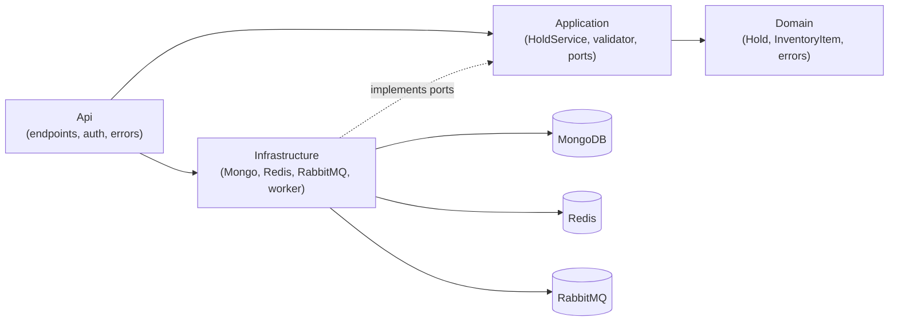

### Folder tree

```
Zeenee-poc/
├── InventoryHold.sln
├── Directory.Build.props          shared build settings (net10.0, nullable, warnings are errors)
├── .editorconfig                  code style rules checked by dotnet format
├── docker-compose.yml             the whole stack in one command
├── .env.example  .gitignore  .dockerignore
├── README.md  IMPLEMENTATION_PLAN.md  IMPLEMENTATION_EXPLAINED.md (this file)
├── Stoplight/inventory-hold.openapi.yaml     the API contract
├── src/
│   ├── InventoryHold.Domain/          Hold.cs, InventoryItem.cs, DomainExceptions.cs
│   ├── InventoryHold.Application/     HoldService.cs, CreateHoldRequestValidator.cs, HoldOptions.cs,
│   │                                  DependencyInjection.cs, Abstractions/Ports.cs,
│   │                                  Contracts/Dtos.cs, Contracts/HoldEvents.cs
│   ├── InventoryHold.Infrastructure/  Mongo/*, Redis/*, Messaging/*, Health/*, InMemory/*,
│   │                                  HoldExpiryWorker.cs, DependencyInjection.cs, AssemblyInfo.cs
│   └── InventoryHold.Api/             Program.cs, Endpoints/HoldEndpoints.cs, Security/ApiKeyAuthentication.cs,
│                                      Http/ApiExceptionHandler.cs, Http/CorrelationIdMiddleware.cs,
│                                      appsettings.json, Properties/launchSettings.json, Dockerfile
├── tests/
│   ├── InventoryHold.Tests/              58 unit + HTTP tests, no external services
│   └── InventoryHold.IntegrationTests/   tests against the running docker compose stack
└── web/                               React + TypeScript + Vite UI, nginx config, Dockerfile, Playwright specs
```

---

## 3. End-to-end flows

### 3.1 The big picture: one request through every layer

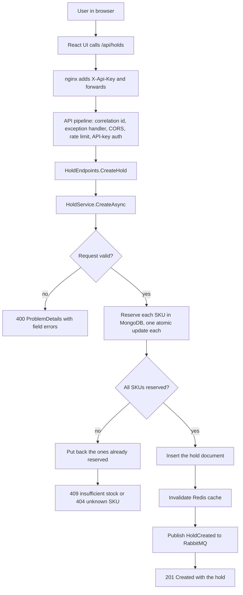

### 3.2 Create a hold (sequence)

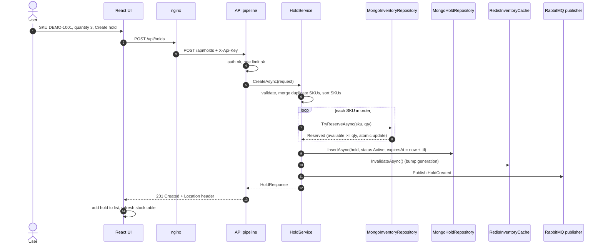

### 3.3 Not enough stock (all or nothing)

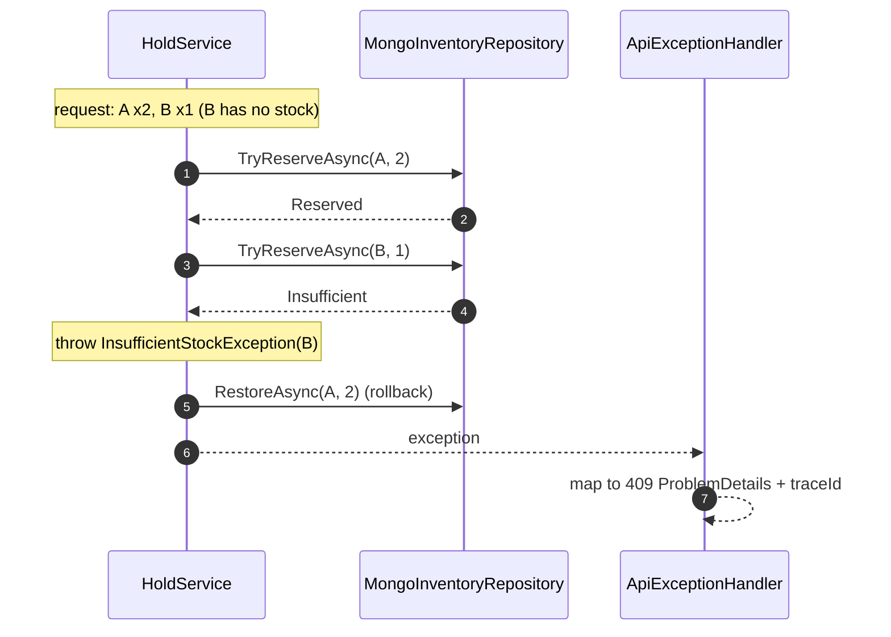

### 3.4 Release a hold, and why stock is restored once

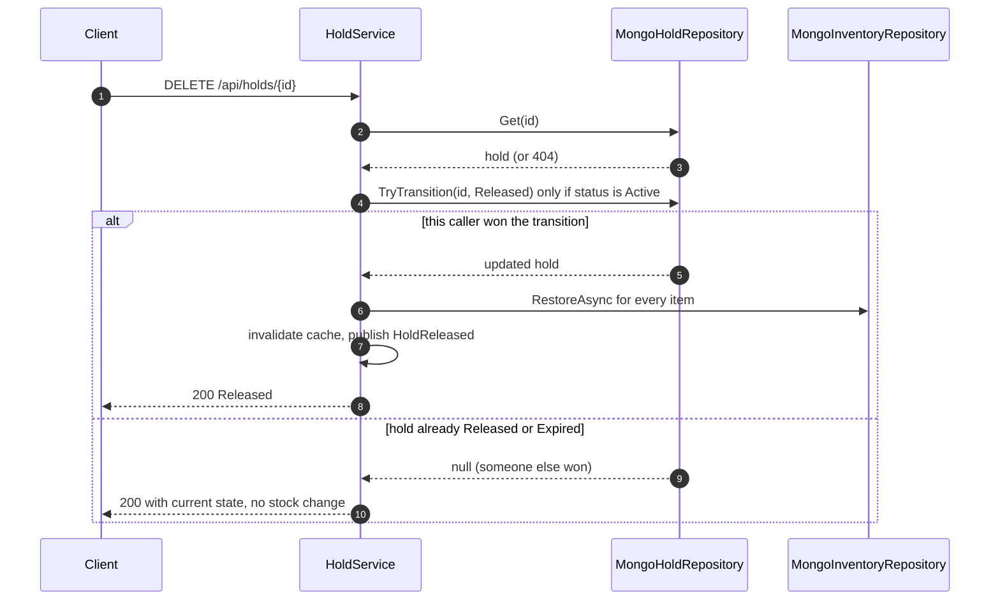

### 3.5 Hold expiry (background worker)

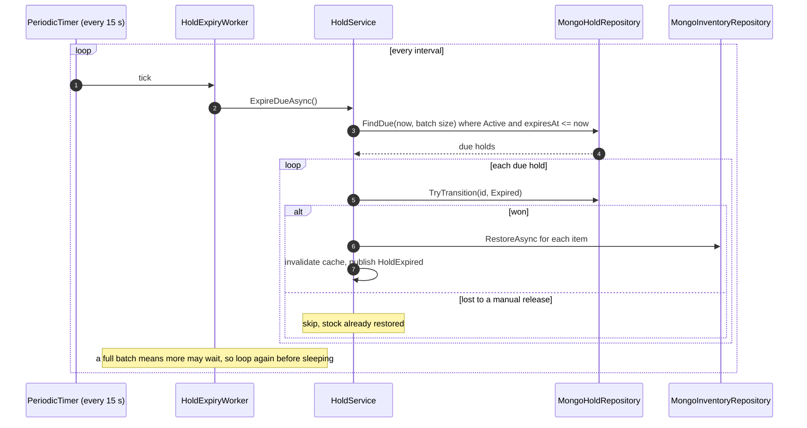

### 3.6 Reading stock with the Redis cache

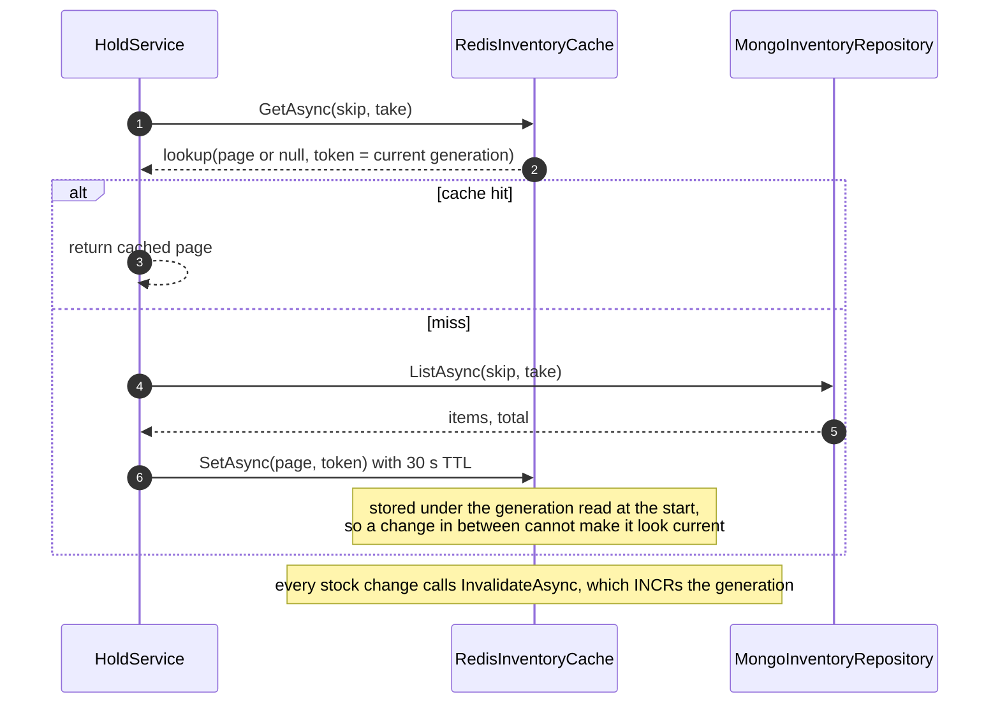

### 3.7 Hold life cycle

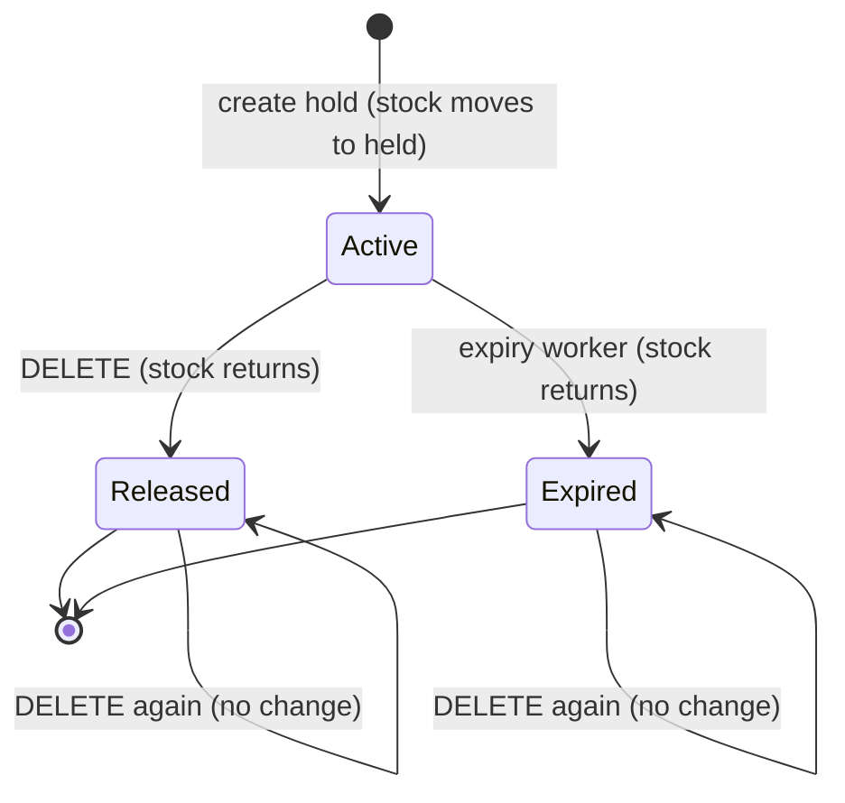

### 3.8 Application start-up (Docker)

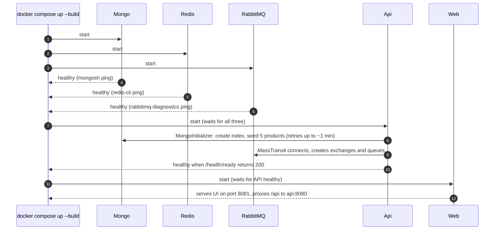

### 3.9 Docker network and ports

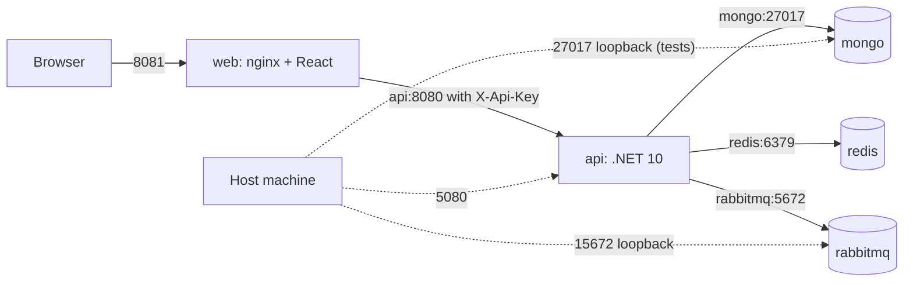

### 3.10 How errors become responses

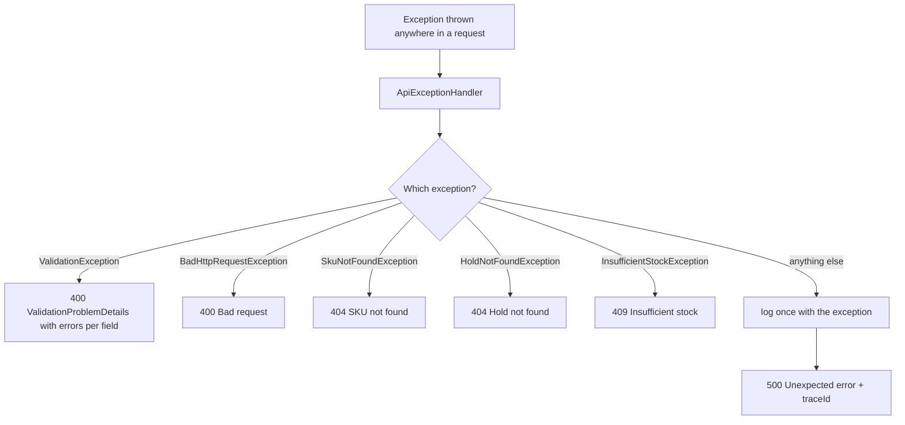

---

## 4. Domain layer

Project: `src/InventoryHold.Domain`. No dependencies. Plain types and rules.

### `Hold.cs`

```csharp
public enum HoldStatus { Active, Released, Expired }

public sealed record HoldItem(string Sku, int Quantity);

public sealed record Hold(string Id, IReadOnlyList<HoldItem> Items, HoldStatus Status,
    DateTimeOffset CreatedAt, DateTimeOffset ExpiresAt, DateTimeOffset? ReleasedAt)
{
    public bool IsDue(DateTimeOffset now) => Status == HoldStatus.Active && ExpiresAt <= now;
}
```

- `HoldStatus` is the three-state life cycle (see 3.7).
- `Hold` is an immutable **record**: a change creates a new copy (`hold with { Status = ... }`), which avoids hidden shared state.
- `ReleasedAt` is set when the hold leaves `Active`, for both release and expiry.
- `IsDue` answers "should the worker expire this hold now?" Only **Active** holds past their time are due.

### `InventoryItem.cs`

```csharp
public sealed record InventoryItem(string Sku, int Available, int Held)
{
    public int Total => Available + Held;
}
```

One row of stock. `Total` is calculated, never stored, so it cannot drift.

### `DomainExceptions.cs`

Four exceptions that carry business meaning, all deriving from `DomainException`:

| Exception | Raised when | Becomes |
|---|---|---|
| `InsufficientStockException(sku)` | a SKU has less available than requested | 409 |
| `SkuNotFoundException(sku)` | the SKU does not exist | 404 |
| `HoldNotFoundException(holdId)` | no hold with that id | 404 |
| `InventoryInconsistencyException(sku)` | a restore would push `held` below zero (a bug or data corruption) | 500 |

The messages are fixed text; the SKU or id is a property, so logs stay constant and searchable.

---

## 5. Application layer

Project: `src/InventoryHold.Application`. Depends only on Domain. **This is where the logic is.**

### `HoldService.cs` (the heart of the system)

Constructor takes the four ports plus the validator, options, a `TimeProvider` (so tests control the clock) and a logger.

**`CreateAsync`**

```csharp
await validator.ValidateAndThrowAsync(request, cancellationToken);

var lines = request.Items!
    .GroupBy(i => i.Sku!.Trim(), StringComparer.Ordinal)
    .Select(g => new HoldItem(g.Key, g.Sum(i => i.Quantity)))
    .OrderBy(i => i.Sku, StringComparer.Ordinal)
    .ToList();
```

1. **Validate** first. Bad input never reaches the database.
2. **Merge duplicate SKUs** (`A x2` + `A x3` becomes `A x5`) and **sort by SKU**. A fixed order keeps behaviour predictable.

```csharp
try {
    foreach (var line in lines) {
        var result = await inventory.TryReserveAsync(line.Sku, line.Quantity, cancellationToken);
        if (result == ReserveResult.Reserved) { reserved.Add(line); continue; }
        throw result == ReserveResult.UnknownSku ? new SkuNotFoundException(line.Sku)
                                                 : new InsufficientStockException(line.Sku);
    }
    hold = new Hold(Guid.NewGuid().ToString("N"), lines, HoldStatus.Active, now, now.Add(ttl), null);
    await holds.InsertAsync(hold, cancellationToken);
}
catch { await RollbackAsync(reserved); throw; }
```

3. **Reserve each SKU** with one atomic call. `reserved` remembers what succeeded.
4. **Any failure** (no stock, unknown SKU, insert error, cancellation) goes to `catch`, which **puts back every
   SKU already reserved** (`RollbackAsync`) and rethrows. That is the "all or nothing" guarantee.
5. After success: **invalidate the cache**, **publish `HoldCreated`**, return the response.

**`GetAsync`**: load the hold or throw `HoldNotFoundException`.

**`ReleaseAsync`**

```csharp
var released = await holds.TryTransitionAsync(holdId, HoldStatus.Released, time.GetUtcNow(), ct);
if (released is null) { /* someone else already moved it: return current state, restore nothing */ }
await FinishTransitionAsync(released, new HoldReleased(...));
```

Only the caller that **wins** the conditional status change restores stock. A second DELETE gets `null` and just
returns the current state. This is how "restore exactly once" works.

**`ExpireDueAsync`**: finds due holds (a batch), tries the same conditional transition to `Expired` for each, and
restores stock for the ones it won. A failure on one hold is counted, the loop continues, and one summary error is
logged after the loop (not one log line per hold).

**`GetInventoryAsync`**: clamps `skip`/`take` (default 50, maximum 200), reads the cache, falls back to MongoDB, then
stores the page in the cache using the **token** from the read (see 11.4).

**`FinishTransitionAsync`**: shared by release and expiry. It restores every item using `CancellationToken.None`<br/>(once the status changed, the restore must not be cancelled halfway), invalidates the cache, throws an
`AggregateException` if any restore failed (after logging once), otherwise publishes the event.

**`PublishSafelyAsync`**: publishes an event but **catches and logs failures**. A broker outage must not fail a hold.

### `Abstractions/Ports.cs`

The interfaces Infrastructure implements:

| Port | Methods | Purpose |
|---|---|---|
| `IInventoryRepository` | `TryReserveAsync`, `RestoreAsync`, `ListAsync` | atomic stock changes and paging |
| `IHoldRepository` | `InsertAsync`, `GetAsync`, `TryTransitionAsync`, `FindDueAsync` | hold storage; `TryTransitionAsync` is the one-winner compare-and-set |
| `IInventoryCache` | `GetAsync`, `SetAsync`, `InvalidateAsync` | page cache with a generation token |
| `IHoldEventPublisher` | `PublishAsync<T>` | event publishing |

`ReserveResult { Reserved, Insufficient, UnknownSku }` lets the service tell a missing SKU from missing stock.
`InventoryCacheLookup(Page, Token)` carries the cache generation back to `SetAsync`.

### `Contracts/Dtos.cs`

Request and response shapes: `CreateHoldRequest(Items, TtlMinutes)`, `HoldItemRequest(Sku, Quantity)`,
`HoldResponse` (with `HoldResponse.From(hold)`), `HoldItemResponse`, `InventoryItemResponse`, `InventoryPage`.
They are separate from the domain types so the API contract can change without touching the domain.

### `Contracts/HoldEvents.cs`

`HoldCreated`, `HoldReleased`, `HoldExpired`: the messages published to RabbitMQ.

### `CreateHoldRequestValidator.cs`

FluentValidation rules, driven by `HoldOptions`:

- `items`: required, 1 to 50 entries.
- each `sku`: required, at most 64 characters, only letters, digits, `.`, `_`, `-`.
- each `quantity`: 1 to 10 000.
- `ttlMinutes` (if given): 1 to 60.

A failure throws `ValidationException`, which the API turns into a 400 with errors per field.

### `HoldOptions.cs`

Settings bound from the `Holds` section and validated at start-up (`ValidateOnStart`): default and maximum lifetime,
maximum items and quantity, expiry batch size and interval, page sizes.

### `DependencyInjection.cs`

`AddInventoryHoldApplication()` registers the options, `TimeProvider.System`, the validator and `HoldService`.

---

## 6. Infrastructure layer

Project: `src/InventoryHold.Infrastructure`. Implements the ports with real technology.

### MongoDB

**`Mongo/MongoDocuments.cs`**: storage shapes `InventoryDocument` (`Sku` is the `_id`, `Available`, `Held`),
`HoldDocument` (`Id`, `Items`, `Status` as text, UTC dates) and `HoldItemDocument`. Kept separate from the domain
records so database details do not leak upward.

**`Mongo/MongoCollections.cs`**: holds the two collections, `inventory` and `holds`.

**`Mongo/MongoOptions.cs`**: `MongoOptions` (connection string, database) and `SeedOptions` (`Enabled`).

**`Mongo/MongoInventoryRepository.cs`** (**where overselling is prevented**)

```csharp
var filter = Builders<InventoryDocument>.Filter.Eq(d => d.Sku, sku)
           & Builders<InventoryDocument>.Filter.Gte(d => d.Available, quantity);
var update = Builders<InventoryDocument>.Update.Inc(d => d.Available, -quantity).Inc(d => d.Held, quantity);
var updated = await collections.Inventory.FindOneAndUpdateAsync(filter, update, ...);
```

`TryReserveAsync` is **one** MongoDB operation: "find this SKU **where available >= quantity** and subtract". MongoDB
applies the check and the change together, so two requests cannot both take the last unit. If nothing matched, a
second query tells "SKU missing" from "not enough stock". `RestoreAsync` does the reverse and requires
`held >= quantity`, otherwise throws `InventoryInconsistencyException`. `ListAsync` sorts by SKU and pages.

**`Mongo/MongoHoldRepository.cs`**

`TryTransitionAsync` filters on `Id` **and `Status == Active`**, then sets the new status. That is a
**compare-and-set**: when many callers race, MongoDB lets exactly one match, and only that one gets the document
back. `FindDueAsync` selects `Active` holds with `ExpiresAt <= now`, oldest first, limited to a batch.
`InsertAsync` and `GetAsync` convert between document and domain record.

**`Mongo/MongoInitializer.cs`**

A hosted service that runs at start-up: creates the index `(status, expiresAt)` that makes `FindDueAsync` fast, then
seeds five products with `UpdateOne ... IsUpsert ... SetOnInsert`. **`SetOnInsert` only writes when the document is new,
so seeding twice never resets stock.** The whole step retries up to 20 times, 3 seconds apart, when MongoDB is not ready yet.

### Redis

**`Redis/RedisInventoryCache.cs`**

Caches inventory pages for 30 seconds under keys like `inventory:page:g7:0:50`, where `7` is a **generation number**.
`InvalidateAsync` does one `INCR` on `inventory:generation`, which instantly makes every old key unreachable. Every
Redis call is wrapped so a Redis failure becomes a **cache miss**, never an API error. `Redis/RedisOptions.cs` holds the
connection string and TTL.

### RabbitMQ (MassTransit)

**`Messaging/MassTransitHoldEventPublisher.cs`**: publishes an event with a **5-second timeout**, so a broker outage
cannot hold a request open.

**`Messaging/HoldEventLogConsumer.cs`**: a sample consumer for all three events (logs them). It shows how other
services would subscribe. Failed messages are retried and then parked in the endpoint's `_error` queue.

**`Messaging/RabbitMqOptions.cs`**: host, port, virtual host, user, password, retry count and interval.

### Background job

**`HoldExpiryWorker.cs`**: a `BackgroundService` using `PeriodicTimer`. It runs once at start, then every
`ExpiryIntervalSeconds`. Each run creates a scope, calls `HoldService.ExpireDueAsync`, and **repeats while a full batch
was processed**. An unexpected error is logged and the next tick retries. It uses the injected `TimeProvider`, so tests
can move time forward instantly.

### Health, DI and demo

**`Health/DependencyHealthChecks.cs`**: `MongoHealthCheck` (ping) and `RedisHealthCheck` (ping; reports *Degraded*, not
*Unhealthy*, because the cache can be missing without breaking the service). Tagged `ready`.

**`DependencyInjection.cs`**: `AddInventoryHoldInfrastructure()` wires options (validated at start), the Mongo client<br/>(10 s server selection timeout), repositories, the initializer, the Redis connection (`AbortOnConnectFail = false`),
MassTransit with retry, the publisher, the expiry worker and the health checks.

**`InMemory/InMemoryDemo.cs`**: in-memory versions of the repositories, a "no cache", and a publisher that only logs.
Enabled with `Demo__InMemory=true` so the API runs with no infrastructure at all. Used for the demo and Visual Studio F5.

**`AssemblyInfo.cs`**: lets the integration test project see the internal repository classes.

---

## 7. Api layer

Project: `src/InventoryHold.Api`. Thin: it turns HTTP into calls to `HoldService` and back.

### `Endpoints/HoldEndpoints.cs`

Minimal-API endpoints (no controller classes). One route group `/api`, which **requires authorization** and the
`api` rate-limit policy:

| Route | Handler | Returns |
|---|---|---|
| `POST /api/holds` | `CreateHold` | `201 Created` + `Location: /api/holds/{id}` |
| `GET /api/holds/{holdId}` | `GetHold` | `200` |
| `DELETE /api/holds/{holdId}` | `ReleaseHold` | `200` with the hold's current state |
| `GET /api/inventory?skip&take` | `GetInventory` | `200` page |

Each handler is one line: call the service, wrap the result. The `.Produces(...)` / `.ProducesProblem(...)` calls
feed the generated OpenAPI document.

### `Program.cs` (start-up, in order)

1. Hide the `Server` header.
2. Bind and validate `Auth:ApiKey`.
3. Register API-key authentication and authorization.
4. CORS policy `web` (only the origins listed in config; none by default).
5. Rate limiter: fixed window, 300 requests per minute per client address, answers 429.
6. Health checks, the exception handler, ProblemDetails, OpenAPI.
7. Add the Application services, then **either** the in-memory demo **or** the real Infrastructure
   (`Demo:InMemory` decides).
8. Request pipeline order: correlation id → exception handler → status pages → HSTS (outside Development) → CORS →
   rate limiter → authentication → authorization.
9. `/health/live` (always OK, no checks) and `/health/ready` (runs the `ready` checks), both anonymous.
10. `/openapi/v1.json` in Development or when `Docs:OpenApi` is true.
11. Map the four endpoints and run.

`public partial class Program;` at the end lets the test project start the real app.

### `Security/ApiKeyAuthentication.cs`

`ApiKeyAuthenticationHandler` reads the `X-Api-Key` header and compares it with the configured key using
`CryptographicOperations.FixedTimeEquals` (constant time, so the key cannot be guessed from response timing). Missing
header means "not authenticated" (401); a wrong key fails (401). `ApiKeyOptions` requires a key of at least 16 characters.

### `Http/ApiExceptionHandler.cs`

The **only** place that turns exceptions into HTTP responses (see diagram 3.10). Expected errors answer 4xx and are
not logged as errors. Anything else is **logged once** and answers `500` with a `traceId` so a user's report can be
matched to the log. It serialises using the runtime type so a validation response keeps its `errors` field.

### `Http/CorrelationIdMiddleware.cs`

Reads `X-Correlation-Id` (accepts only short letters, digits, `-`, `_`), or creates one, returns it on the response and
adds it to the log scope, so one request can be followed through the logs.

### `appsettings.json`, `Properties/launchSettings.json`, `Dockerfile`

- `appsettings.json`: development **placeholder** settings (API key, MongoDB, Redis, RabbitMQ `guest/guest`). Docker overrides all of them with environment variables. Replace before real use.
- `launchSettings.json`: two Visual Studio profiles, **InMemory demo** (default) and **Real infrastructure (localhost)**.
- `Dockerfile`: builds with the .NET SDK image, runs on the ASP.NET image as a non-root user on port 8080.

---

## 8. Frontend (web)

Project: `web/`. React 19, TypeScript, Vite. Talks only to `/api/...` on its own address.

| File | What it does |
|---|---|
| `index.html`, `src/main.tsx` | Page shell; mounts `<App />` |
| `src/App.tsx` | Page state: inventory, list of holds (ids kept in `localStorage`), refresh every 10 s, create and release handlers |
| `src/api/types.ts` | TypeScript types matching the API JSON |
| `src/api/client.ts` | `api.getInventory/createHold/getHold/releaseHold`; `ApiError` keeps status, title, trace id and field errors; network failure becomes an `ApiError` with status 0 |
| `src/components/InventoryTable.tsx` | Stock table with loading, empty and error states; out-of-stock shown in red |
| `src/components/CreateHoldForm.tsx` | Several SKU lines, hold-time input, client-side checks, shows server errors and trace id |
| `src/components/HoldCard.tsx` | One hold: items, status badge, live countdown, Release button |
| `src/components/ErrorNotice.tsx` | Error box with "Try again" and the visible **trace id** |
| `src/hooks/useNow.ts` | Ticks every second so countdowns update |
| `src/styles.css` | Responsive layout (phone and desktop), dark mode, visible focus |
| `vite.config.ts` | Dev server on 5173; **proxies `/api` and adds the API key on the server side**; Vitest settings |
| `nginx.conf.template` | Production: serves the built UI and proxies `/api` to the API with the key; security headers |
| `Dockerfile` | Builds the UI with Node, serves it with nginx |
| `playwright.config.ts`, `e2e/holds.spec.ts` | Browser tests for create, release and the error path (desktop and mobile) |
| `src/**/*.test.ts(x)` | 25 Vitest tests |

Two ideas to point out:

- **The browser never holds the API key.** The key lives in nginx (Docker) or the Vite proxy (development).
- **Errors are shown as plain sentences plus a trace id**, so a support request can be matched to the server log.

Flow in the UI:

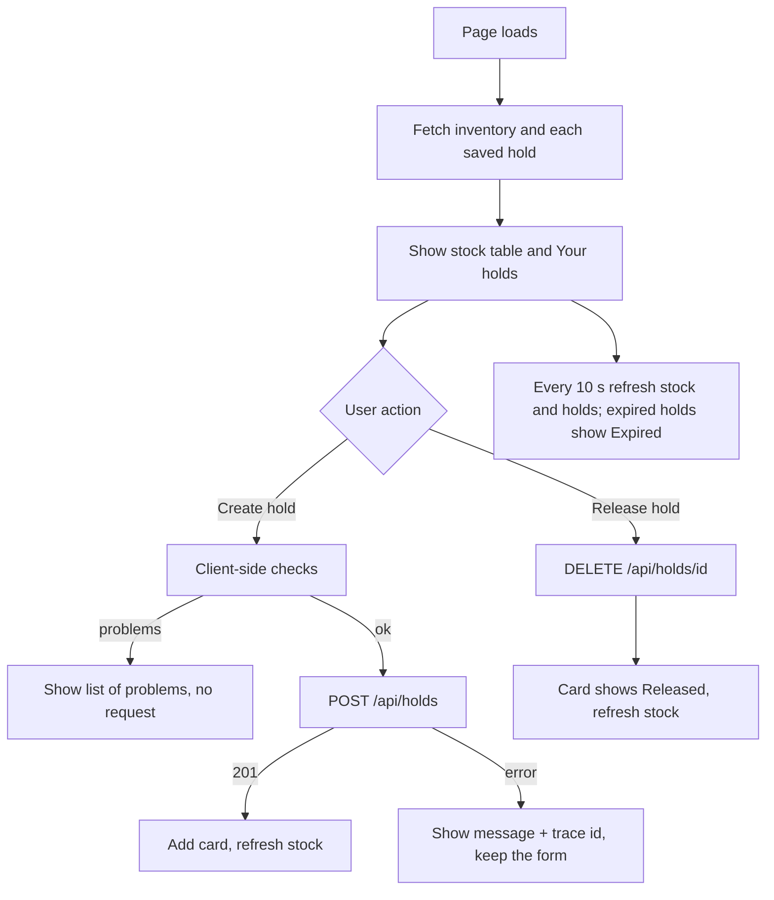

---

## 9. Docker, configuration and tooling

### `docker-compose.yml`

Five services; every `${VAR:-default}` has a default, so **no `.env` is needed**.

| Service | Image | Notes |
|---|---|---|
| `mongo` | `mongo:7` | volume `mongo-data`; published on loopback 27017 for the tests; health check `mongosh ping` |
| `redis` | `redis:7-alpine` | no persistence; `volatile-lru` so the generation counter is never evicted |
| `rabbitmq` | `rabbitmq:4-management` | volume `rabbitmq-data`; management UI on loopback 15672 |
| `api` | built from `src/InventoryHold.Api/Dockerfile` | waits for the three above to be healthy; health check calls `/health/ready` |
| `web` | built from `web/Dockerfile` | waits for the API to be healthy; serves port 8081 |

Containers use service names (`mongo`, `redis`, `rabbitmq`, `api`), never `localhost`.

### Other files

| File | Purpose |
|---|---|
| `Directory.Build.props` | `net10.0`, nullable on, **warnings are errors** for every project |
| `.editorconfig` | formatting and naming rules enforced by `dotnet format` |
| `.env.example` | optional overrides (ports, key, password, seeding, lifetime) |
| `.gitignore`, `.dockerignore`, `web/.dockerignore` | keep build output and secrets out of git and images |
| `Stoplight/inventory-hold.openapi.yaml` | hand-written API contract with examples and error responses |
| `IMPLEMENTATION_PLAN.md` | the approved plan and its decisions |
| `README.md` | how to run, verify and troubleshoot |

---

## 10. Tests

**`tests/InventoryHold.Tests`** (58 tests, no external services)

| File | What it proves |
|---|---|
| `CreateHoldTests.cs` | stock moves to held; default and custom lifetime; insufficient stock; unknown SKU; **second SKU fails so the first is restored**; insert failure restores stock; duplicate SKUs merge; cache invalidated and event published; broker down still succeeds; 8 invalid requests; **60 concurrent requests for 10 units give exactly 10 holds** |
| `ReleaseAndExpiryTests.cs` | release restores stock; **releasing twice restores once**; **25 concurrent releases restore once**; expiry after the lifetime; no expiry before it; release then expiry does not double-restore; one failing hold does not stop the others |
| `InventoryQueryTests.cs` | totals; second call served from cache; cache refreshed after a hold and after a release; page-size clamping; paging |
| `HoldExpiryWorkerTests.cs` | the real worker, with a fake clock, expires a hold and returns stock |
| `Api/ApiFactory.cs`, `Api/HoldApiTests.cs` | the **real HTTP pipeline**: 401 without key, 201 with `Location`, 400 with field errors, 409, 404, repeat DELETE, health is anonymous, no `Server` header, correlation id echoed, OpenAPI lists the four operations |
| `Support/Fakes.cs`, `Support/Harness.cs` | in-memory ports and a ready-made service for tests |

**`tests/InventoryHold.IntegrationTests`** (need the running compose stack)

| File | What it proves |
|---|---|
| `StackFixture.cs` | connects to the stack and seeds uniquely named SKUs |
| `LiveStackTests.cs` | all dependencies healthy; five seeded products; the Redis cache stays current; **60 simultaneous requests against real MongoDB**; all-or-nothing; repeat release; events reach RabbitMQ and are consumed; a hold expires by itself |
| `MongoFixture.cs`, `MongoRepositoryTests.cs` | the repositories against real MongoDB: concurrent reserve, restore guard, one-winner transition, due query, round trip |

**Frontend**: 25 Vitest tests (client, form, hold card, whole app) and 3 Playwright specs.

---

## 11. Key design ideas

### 11.1 Why it cannot oversell
The reserve is **one conditional update**: subtract only where `available >= quantity`. The database performs the check
and the change as one step, so there is no gap between "check" and "update" for another request to slip into.

### 11.2 Why stock is restored exactly once
Release and expiry both need the hold to be `Active` to change it. The status change is a conditional update too, and
only **one** caller can win it. Only the winner restores stock. Everyone else gets the current state back.

### 11.3 Why multi-SKU holds are all or nothing without transactions
SKUs are reserved one at a time; if one fails, the earlier ones are put back. This needs no multi-document
transaction, so a single MongoDB node is enough. The cost is a small crash window (see 13).

### 11.4 Why the cache cannot show old data
Cache keys include a **generation**. Every stock change increments it, which retires all cached pages at once. A reader
remembers the generation it started with and stores its result under **that** generation, so a result loaded before a
change can never be stored as current.

### 11.5 Why a broker or cache outage does not break holds
Redis errors become cache misses. Event publishing has a 5-second timeout and its failures are logged, not thrown.
MongoDB is the only hard dependency.

### 11.6 Time is injectable
Everything that depends on the clock uses `TimeProvider`. Tests move a fake clock forward instead of waiting.

### 11.7 Security basics included
API-key auth with constant-time comparison, rate limiting, named CORS policy, no `Server` header, validated
configuration at start-up, no stack traces in responses, trace id instead of internal details, non-root container.

---

## 12. Suggested order for presenting

1. **The idea** (section 1) and the state diagram (3.7).
2. **Architecture** (section 2): why Application knows nothing about MongoDB.
3. **Create a hold** end to end: diagram 3.2, then `HoldService.CreateAsync`, then `MongoInventoryRepository.TryReserveAsync`.
4. **The failure case** (3.3): rollback.
5. **Release and expiry** (3.4, 3.5): the compare-and-set in `MongoHoldRepository.TryTransitionAsync`.
6. **Cache and events** (3.6, `RedisInventoryCache`, `MassTransitHoldEventPublisher`).
7. **The HTTP layer**: `HoldEndpoints`, `Program.cs` order, `ApiExceptionHandler` (3.10).
8. **The UI** (section 8) and the live demo.
9. **Docker** (3.8, 3.9, section 9).
10. **Tests** (section 10): point at the concurrency tests.
11. **Honest limits** (section 13).

Live demo ideas (run the API in demo mode or the full stack): create a hold and watch available drop; ask for
`DEMO-1005` (no stock) to show the 409 with a trace id; fire 60 parallel requests at `DEMO-1003` and show exactly 5
succeed; release twice and show stock restored once; create a 1-minute hold and watch it expire.

---

## 13. What is proven and what is not

| Item | Status |
|---|---|
| .NET build with warnings as errors, format check | run, passes |
| 58 .NET tests, 25 frontend tests, frontend build | run, pass |
| Live demo of API and UI in in-memory mode | run, worked |
| Docker images, `docker compose up`, container health checks | **not run** (Docker not available where this was built) |
| Integration tests against the stack, Playwright E2E | **not run**, same reason |
| Real MongoDB, Redis, RabbitMQ behaviour | **not run**; the oversell protection is proven only against in-memory stand-ins |

Known limitations (also in the README):

- **Crash window**: a crash after reserving stock but before saving the hold leaves that stock held with no hold to
  expire it. A MongoDB replica set with a transaction would close it.
- **No transactional outbox**: an event can be lost if the process dies right after the state change.
- **Expiry lag**: a hold stays `Active` until the worker's next tick (up to 15 seconds after its time).
- **One shared API key**, no per-user identity.
- **MongoDB has no authentication** in the compose file (published on loopback only).
